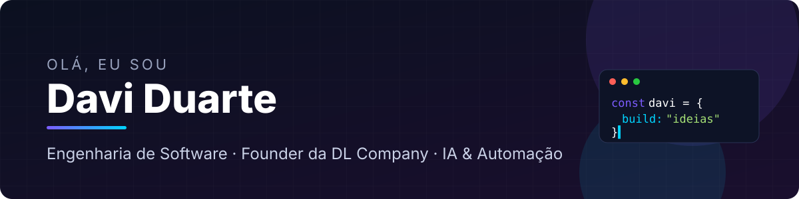

  

  
  
  

## 👋 Sobre mim

- 🎓 Estudante de **Engenharia de Software** em São Luís (MA)
- 🚀 Fundador da **DL Company** — marketing automotivo com IA no WhatsApp/Instagram, CRM, tráfego pago e landing pages
- 💧 Sócio da **Acqua Inovare** — startup de monitoramento de água (Sebrae Startup Supernova)
- 🤖 Curto IA, agentes e automações — construindo coisas com Claude Code
- 🚗 Apaixonado por carros, empreendedorismo, tecnologia e design

## 🛠️ Stack

  

## 📌 Projetos em destaque

| Projeto | O que é | Stack |
|---|---|---|
| 💰 **DV Finance** | App de finanças pessoais (PWA) com registro rápido de gastos | Next.js · Supabase · Vercel |
| 🛍️ [Plataforma Ludovicense](https://github.com/davipduartee/Plataforma-Inteligente-Buscadora-Recomendadora-Ludovicense) | Ajuda consumidores de São Luís a decidir entre comprar local ou online com IA | Design · Front-end |
| 📊 [Sistema de Análise de Dados](https://github.com/davipduartee/sistema-analise-dados) | Arquivos, regex e tratamento de exceções | Python |
| 🧩 [Arrays, DOM e Eventos](https://github.com/davipduartee/arrays-dom-eventos) | Desafios práticos de JavaScript | JavaScript |
| ⚡ [Desafio Semana 05](https://github.com/davipduartee/desafio-semana-05) | Pedidos, buscador de CEP e mini Pokédex | JavaScript |
| 🎨 [Portfólio Pessoal](https://github.com/davipduartee/Portif-lio-Pessoal) | Apresentação, habilidades e projetos | Figma Make |

## 📈 Atividade

  
  

  

## 📫 Contato

  

<i>“Tudo posso naquele que me fortalece.” — Filipenses 4:13</i>

